## 1. Identificación del Proyecto, Versión y Enlaces de Respaldo

| Artefacto / Recurso | Identificador / Enlace | Descripción y Permisos |
| :--- | :--- | :--- |
| **Repositorio Oficial** | [GitHub: Diego-017/Chambazo-2026-Sprint-2](https://github.com/Diego-017/Chambazo-2026-Sprint-2) | Rama `main`. Permiso de lectura/colaboración otorgado a la docente. |
| **Identificador de Versión** | Commit `61e9f78` / Tag `v3.0.0-sprint3-final` | Versión congelada para evaluación del Parcial II con el Sprint 3 completo. |
| **Video de Demostración** | [Enlace al Video de Demostración (8 min)](https://ugbedu-my.sharepoint.com/:w:/g/personal/smss097824_ugb_edu_sv/cQrJ7s18Pm6oT6PykLP1VrKvEgUCr0ggPAwgF2_-VBkpVdI3Xg) | Video con audio claro y demostración del sistema en ejecución. |
| **Carpeta de Evidencias (Drive / OneDrive)** | [OneDrive Oficial UGB - Sprint 3](https://ugbedu-my.sharepoint.com/:w:/g/personal/smss097824_ugb_edu_sv/cQrJ7s18Pm6oT6PykLP1VrKvEgUCr0ggPAwgF2_-VBkpVdI3Xg) | Permisos de edición |
| **Tablero de Gestión (Jira / Trello)** | Tablero Sprint 3 — Chambazo SV | Estado de historias de usuario: *To Do*, *In Progress*, *Testing*, *Done*. |
| **Suite de Pruebas** | `django.test.runner` (`20/20 PASA`) | Archivo [`core/tests.py`](file:///C:/Users/Admin/Desktop/version%2011/Chambazo-2026-Sprint-2-main/core/tests.py) con ejecución en $31.7\,\text{s}$. |

---

## 2. Cumplimiento del Sprint Goal y Alcance Comprometido 

### 2.1. Declaración del Sprint Goal
> **Sprint Goal:**  
> *"Consolidar una experiencia integral de contratación confiable y ágil mediante la evaluación y selección multidimensional de candidatos (comparador lado a lado, descarga de CVs y descarte fundamentado), la trazabilidad en vivo de postulaciones, la mitigación de vulnerabilidades de seguridad, y la incorporación de un modelo de membresías por suscripción con navegación altamente interactiva y fluida."*

### 2.2. Estado de Historias de Usuario del Sprint 3

| Código HU | Historia de Usuario | Estado | Criterio de Aceptación Clave Comprobado |
| :--- | :--- | :--- | :--- |
| **HU032** | Selección de candidato con validación de verificación | **Terminada (Done)** | El contratista puede seleccionar al candidato idóneo; si la vacante exige verificación, se valida la insignia antes de confirmar. |
| **HU033** | Descarga de currículum vitae en PDF | **Terminada (Done)** | Generación con ReportLab descargable en $< 2.0\,\text{s}$ con experiencia laboral, habilidades y referencias. |
| **HU034** | Descarte de postulante con registro de motivo | **Terminada (Done)** | Modal de descarte con motivos predefinidos, actualización de estado en BD y notificación de retroalimentación. |
| **HU035** | Notificación al enviar postulación | **Terminada (Done)** | Emisión de alerta inmediata en el feed del trabajador y registro de evento en la vacante. |
| **HU036** | Notificación por cambio de estado de solicitud | **Terminada (Done)** | Notificación visual y push simulada al pasar de *En Revisión* a *Aceptado/Rechazado*. |
| **HU037** | Consulta detallada de estado de postulación | **Terminada (Done)** | Panel detallado donde el trabajador inspecciona el historial de cada vacante aplicada. |
| **HU038** | Actualización en tiempo real de eventos | **Terminada (Done)** | Actualizaciones reactivas en interfaz sin requerir recarga manual agresiva. |
| **HU039** | Stepper / Barra de seguimiento cronológico | **Terminada (Done)** | Línea de tiempo visual con 5 fases (*Enviada → Revisión → Aceptada → En Progreso → Finalizada*). |
| **HU040** | Notificación de mensajes nuevos en chat | **Terminada (Done)** | Contador flotante de mensajes sin leer con animación de pulso en el sidebar. |
| **HU041** | Configuración de preferencias de notificación | **Terminada (Done)** | Pantalla para activar/desactivar alertas por correo, push y avisos de nuevas vacantes. |
| **HU042** | Guardado de ofertas en favoritos | **Terminada (Done)** | Acción toggle con feedback visual para marcar vacantes de interés y consultarlas luego. |
| **HU043** | Calificación con estrellas al empleador | **Terminada (Done)** | Formulario interactivo de estrellas (1-5) y comentario al concluir un servicio. |
| **HU044** | Calificación integral al trabajador | **Terminada (Done)** | Evaluación de puntualidad, calidad técnica y trato personal con cálculo automático de promedio. |
| **HU045** | Perfil público y reputación de la empresa | **Terminada (Done)** | Vista pública de perfil con historial de contrataciones y calificaciones acumuladas. |
| **HU046** | Evaluador y comparador de candidatos | **Terminada (Done)** | Vista lado a lado de postulantes comparando afinidad, tarifa, educación y habilidades. |
| **HU047** | Indicador integral de confianza y reputación | **Terminada (Done)** | Badge dinámico (*Nivel de Confianza*) calculado en función de valoraciones y verificaciones KYC. |
| **HU048** | Reporte de reseñas inapropiadas o falsas | **Terminada (Done)** | Modal de denuncia que envía la reseña a la cola de moderación del administrador. |
| **HU-SUB01** | Modelo de Planes de Suscripción y Cuotas | **Terminada (Done)** | Sustitución de cobro por evento por planes mensuales (Básico, Pro, Premium) con cuotas y widget de uso. |

---

## 3. Demostración del Incremento Funcional 

El incremento entregado en el Sprint 3 cuenta con los siguientes flujos principales probados con datos de prueba realistas:

```mermaid
flowchart TD
    subgraph Empleador ["Flujo de Empleador / Contratista"]
        A[Publicar Vacante con Cupo de Plan] --> B[Fijar Ubicación con Mapa Esri ArcGIS]
        B --> C[Recibir y Comparar Candidatos HU046]
        C --> D[Descargar CV en PDF HU033]
        C --> E[Seleccionar HU032 o Descartar con Motivo HU034]
    end
    subgraph Trabajador ["Flujo de Trabajador"]
        F[Buscar Vacantes en Mapa Interactivo] --> G[Postulación Inmediata 1-Clic con Cupo]
        G --> H[Seguimiento de Estado en Stepper HU039]
        H --> I[Ajuste de Preferencias de Alertas HU041]
    end
    subgraph Monopolio ["Monetización y Calidad"]
        J[Planes de Pago: Básico / Pro / Premium] --> K[Consumo de Cuotas Mensuales en BD]
        K --> L[Suite de Animaciones y Micro-interacciones Globales]
        L --> M[Calificaciones Bidireccionales HU043-HU048]
    end
```



### 3.1. Flujo 1: Contratación y Gestión de Candidatos (HU032, HU033, HU034, HU046)
* **Comparador de Candidatos:** Permite a la empresa contrastar simultáneamente a los postulantes de una vacante evaluando porcentaje de coincidencia (*match score*), tarifa solicitada, experiencia y disponibilidad de vehículo.
* **Descarga de CV (ReportLab):** Genera dinámicamente un documento profesional en formato PDF con la hoja de vida del trabajador en tiempo récord ($< 0.8\,\text{s}$).
* **Descarte con Retroalimentación:** Si un candidato no encaja, el contratista selecciona un motivo (*"Pretensión salarial fuera de rango"*, *"Perfil no se ajusta"*, etc.), garantizando transparencia sin dejar procesos inconclusos.

### 3.2. Flujo 2: Trazabilidad y Notificaciones (HU035 – HU042)
* **Stepper Cronológico:** El trabajador visualiza el avance exacto de su postulación mediante una barra de estado con iconos descriptivos (*Enviada → En Revisión → Aceptada → En Progreso → Concluida*).
* **Centro de Preferencias:** Los usuarios configuran qué alertas desean recibir en su correo y cuáles en la plataforma, previniendo saturación de notificaciones.

### 3.3. Flujo 3: Modelo de Monetización por Planes y Membresías (HU-SUB01)
* **Eliminación de la fricción:** Se descartó el cobro individual por cada publicación (`$2.50`) y por cada aplicación (`$1.50`), sustituyéndolo por un sistema de cuotas mensuales automáticas:
  * **Contratistas:** Plan Básico (2 vacantes/mes gratis), Pro (15 vacantes/mes por `$14.99`), Premium (Ilimitadas por `$29.99`).
  * **Trabajadores:** Plan Básico (5 aplicaciones/mes gratis), Pro (30 aplicaciones/mes por `$4.99`), Premium (Ilimitadas por `$9.99`).
* **Widget en Barra Lateral:** Muestra en tiempo real la barra de consumo mensual, cupo restante y botón para subir de nivel en un solo clic.

### 3.4. Flujo 4: Suite de Animaciones y Experiencia de Usuario
* **Landing Page Interactiva:** Badges flotantes (`heroFloat`), botón de búsqueda con pulso luminoso (`heroGlow`), categorías de oficios con micro-rotación dinámica en `:hover` y banner con pulso sutil.
* **Micro-interacciones en Todo el Sistema:** Tarjetas con elevación suave (`card-lift`), botones con destello de brillo (*shimmer*), modales con apertura elástica (*modalSpring*) y mapa sin bloqueos ni errores 403.

---

## 4. Evidencias de Calidad, Pruebas y Decisiones Técnicas 

### 4.1. Modelo de Calidad y Requisitos Medibles (ISO/IEC 25010 y 25012)

| Característica / Métrica | Requisito Medible | Meta Definida | Resultado Obtenido en Sprint 3 | Estado |
| :--- | :--- | :--- | :--- | :--- |
| **Eficiencia de Rendimiento (RNF-01)** | Tiempo de respuesta en selección de candidatos | $< 2.0\,\text{s}$ | **0.12 segundos** (desacoplamiento asíncrono SMTP) | **Cumplido** |
| **Seguridad de la Información (RNF-02)** | Resistencia a ataques XSS en formularios de vacantes | 0 scripts ejecutados | **0 vulnerabilidades** (implementación de `json_script`) | **Cumplido** |
| **Seguridad Criptográfica (RNF-03)** | Generación de tokens y códigos OTP | PRNG no predecible | **Módulo `secrets` estándar** de Python aplicado | **Cumplido** |
| **Usabilidad / Operabilidad (CP-02)** | Tareas de navegación y postulación sin fallos | $\ge 90\%$ | **100% de flujos completables en 1 clic** | **Cumplido** |
| **Exactitud y Consistencia de Datos (CD-02)** | Integridad de cupos de planes de suscripción | $100\%$ consistencia | Descuento atómico de cuota verificado por test unitario | **Cumplido** |

### 4.2. Matriz de Casos de Prueba Automatizados y Resultados (20/20 PASA)

Toda la lógica crítica está respaldada por una suite automatizada en Django (`core/tests.py`):

| ID Test Case | Funcionalidad / HU Evaluada | Tipo de Prueba | Requisito Verificado | Resultado |
| :--- | :--- | :--- | :--- | :--- |
| **TC-SELCAND3-001** | Selección de candidato con verificación previa | Integración | HU032 / CP-03 | **PASA** |
| **TC-DESCV3-001** | Generación y descarga de CV en formato PDF | Funcional | HU033 / CD-06 | **PASA** |
| **TC-DESCAND3-001** | Descarte de candidato con motivo y notificación | Integración | HU034 / CD-05 | **PASA** |
| **TC-NOTPOST3-001** | Creación y emisión de notificación de postulación | Unitaria | HU035 / CP-01 | **PASA** |
| **TC-NOTEST3-001** | Notificación por transición de estados de solicitud | Unitaria | HU036 / CP-02 | **PASA** |
| **TC-CONSPOST3-001** | Inspección del detalle y motivo de postulación | Funcional | HU037 / CP-02 | **PASA** |
| **TC-SEGSOL3-001** | Persistencia cronológica en línea de tiempo | Unitaria | HU039 / CP-02 | **PASA** |
| **TC-MSGNOT3-001** | Alerta por recepción de mensajes en el chat | Funcional | HU040 / CP-02 | **PASA** |
| **TC-PREFNOT3-001** | Guardado de matriz de preferencias de usuario | Integración | HU041 / CD-11 | **PASA** |
| **TC-GUARDAROF3-001** | Marcado y desmarcado de vacantes favoritas | Funcional | HU042 / CP-02 | **PASA** |
| **TC-CALEMP3-001** | Registro de reseña y estrellas para el empleador | Integración | HU043 / CD-07 | **PASA** |
| **TC-CALTRAB3-001** | Registro de evaluación al desempeño del trabajador | Integración | HU044 / CD-05 | **PASA** |
| **TC-VERCALEMP3-001** | Recálculo de promedio y reputación del empleador | Unitaria | HU045 / CD-07 | **PASA** |
| **TC-VERCALCAND3-001** | Recálculo de promedio del perfil del postulante | Unitaria | HU046 / CD-07 | **PASA** |
| **TC-CONFIANZA3-001** | Cálculo de insignia de confianza y validación KYC | Unitaria | HU047 / CP-04 | **PASA** |
| **TC-REPRESENA3-001** | Envío de reporte de reseña a moderación admin | Integración | HU048 / RNF-02 | **PASA** |
| **TC-XSS3-001** | Sanitización contra payloads XSS (`<script>alert</script>`) | Seguridad | RNF-02 / OWASP | **PASA** |
| **TC-DEF001-001** | No bloqueo HTTP ante latencia de servidor SMTP | Rendimiento | DEF-001 / RNF-01 | **PASA** |
| **TC-SUBSCRIP-001** | Consumo y control atómico de cupo mensual de plan | Negocio | HU-SUB01 / CD-02 | **PASA** |
| **TC-SUBSCRIP-002** | Acceso a catálogo de planes y cambio de membresía | Integración | HU-SUB01 / CP-02 | **PASA** |

```powershell
# Evidencia de ejecución en consola de desarrollo:
py -3.12 manage.py test core
Ran 20 tests in 31.728s
OK
Destroying test database for alias 'default'...
```

### 4.3. Registro y Cierre de Defectos Técnicos (Gestión de Calidad)

* **DEF-001 — Bloqueo de Peticiones por Servidor de Correo (Latencia):**
  * *Síntoma:* Al seleccionar un candidato, la respuesta HTTP tardaba más de 5 segundos porque el socket SMTP enviaba el correo de forma síncrona.
  * *Solución:* Desacoplamiento asíncrono con hilos secundarios (`threading.Thread(target=_deliver, daemon=True)`).
  * *Validación:* La vista ahora responde en **0.12 segundos**. Estado: **Cerrado**.
* **DEF-002 — Bloqueo 403 en Servidor de Mapas OSM:**
  * *Síntoma:* El servidor de OpenStreetMap bloqueaba las peticiones locales con carteles de `403 Access blocked`.
  * *Solución:* Migración a **Esri ArcGIS World Street Map Tiles**, un servicio gratuito de alta disponibilidad sin cuotas ni bloqueos por IP. Estado: **Cerrado**.
* **DEF-003 — Cierre Prematuro de Scripts por Directivas de Plantilla:**
  * *Síntoma:* En la pantalla de publicación del contratista, el mapa no se dibujaba debido a un error de parsing en la directiva de habilidades.
  * *Solución:* Reorganización de directivas de Django (`json_script` fuera de `<script>`) y ajuste del ciclo de renderizado. Estado: **Cerrado**.

---

## 5. Balance del Sprint 3 y Prioridades hacia la Feria del 1 de Diciembre

### 5.1. Lo Terminado (Done)
1. Flujo completo de selección, comparación y descarte fundamentado de candidatos.
2. Descarga instantánea de currículos en PDF mediante ReportLab.
3. Línea de tiempo visual y centro de configuración de notificaciones.
4. Reseñas y calificaciones con estrellas y moderación de comentarios abusivos.
5. Modelo de suscripciones y membresías por cuotas mensuales (Básico, Pro, Premium).
6. Cartografía interactiva con Esri ArcGIS en publicación, búsqueda y detalle.
7. Suite global de animaciones, micro-interacciones y diseño moderno responsivo.
8. 20 tests unitarios automatizados aprobados y deuda técnica de SonarQube saneada.

### 5.2. Lo Parcial y Limitaciones Persistentes
* **Pasarela de Pagos en Modo Sandbox:** La suscripción a planes Pro/Premium opera actualmente con validación de tarjeta y procesamiento simulado localmente, sin conexión a una pasarela bancaria salvadoreña real (ej. Wompi de Banco Agrícola / Pagadito / Stripe).
* **Notificaciones Push Nativas Móviles:** Las alertas operan en base de datos e interfaz web y correo electrónico, pero aún no cuentan con un Service Worker de Web Push Notifications para dispositivos móviles fuera del navegador.

### 5.3. Prioridades hacia la Feria de Software del 1 de Diciembre
1. **Integración con Pasarela de Pago Real:** Conectar el webhook de Wompi El Salvador o Stripe para cobros con tarjetas de débito/crédito locales.
2. **PWA (Progressive Web App):** Habilitar `manifest.json` y Service Worker para permitir la instalación de Chambazo como app en teléfonos Android/iOS.
3. **Módulo de Reportes y Analíticas Avanzadas:** Dashboard con gráficos interactivos (ApexCharts/Chart.js) para que los contratistas analicen el rendimiento de sus vacantes y tiempos de contratación.

---

```
---

## Guía de preguntas propuestas por el equipo

### Pregunta 1 (Enfoque: Cumplimiento del Sprint Goal y Alcance)
  *«¿De qué manera el incremento de este Sprint 3 aporta directamente a los objetivos del negocio y cómo comprobaron que se cumplió el Sprint Goal?»*

  > *"El Sprint Goal se centró en dos pilares: efectividad en la contratación y sostenibilidad del marketplace. Antes, el empleador no tenía herramientas para comparar postulantes ni descargar su hoja de vida estructurada, y las postulaciones no tenían trazabilidad. Con las HU032 a HU046, el empleador ahora compara candidatos lado a lado, descarga su CV en PDF en menos de un segundo y descarta con motivos claros. Además, sustituimos el cobro repetitivo por tarjeta por un modelo de membresías por cuotas mensuales, eliminando la fricción y asegurando un flujo de negocio comprobado al 100% con nuestras 20 pruebas automatizadas."*

### Pregunta 2 (Enfoque: Calidad, Arquitectura y Defectos Técnicos)

  *«Durante sus pruebas identificaron el defecto DEF-001 y problemas de inyecciones o librerías de mapas; expliquen técnicamente cuál fue la causa raíz y cómo lo remediaron en el código.»*

  > *"En el defecto DEF-001, la vista de selección de candidatos tardaba más de 5 segundos porque se comunicaba síncronamente con el servidor SMTP de Gmail en el mismo hilo de la petición HTTP. Lo solucionamos en `core/email_utils.py` desacoplando el despacho mediante hilos en segundo plano con `threading.Thread`, lo que redujo el tiempo de respuesta a 0.12 segundos, satisfaciendo el requisito RNF-01 de ISO 25010. Asimismo, en seguridad eliminamos la directiva insegura `|safe` reemplazándola por `json_script` de Django para evitar XSS, migramos la generación de tokens al módulo criptográfico estándar `secrets`, y para los mapas sustituimos los tiles bloqueados de OSM por Esri ArcGIS, garantizando alta disponibilidad sin cobros ni bloqueos 403."*

### Pregunta 3 (Enfoque: Decisiones de Producto y Prioridades hacia la Feria)
  *«¿Qué limitaciones persisten en esta versión entregada y qué decisiones de priorización tomaron para asegurar el éxito en la feria del 1 de diciembre?»*

  > *"La principal limitación identificada es que la pasarela de pagos opera actualmente con tarjetas de prueba simuladas en entorno local, y no disponemos todavía de notificaciones push nativas móviles. Hacia la feria del 1 de diciembre, priorizamos en nuestro Product Backlog tres elementos con base en el valor para el usuario final: primero, la integración del webhook de Wompi El Salvador para transacciones financieras reales; segundo, la conversión a PWA para que los trabajadores de oficios instalen la aplicación en sus teléfonos como app nativa; y tercero, un dashboard con analíticas para contratistas sobre el rendimiento de sus contrataciones."*

CHAMBAZO SPRINT 3 2026 CON MUCHO ESFUERZO, CAFÉ Y COMMITS :´)
---
